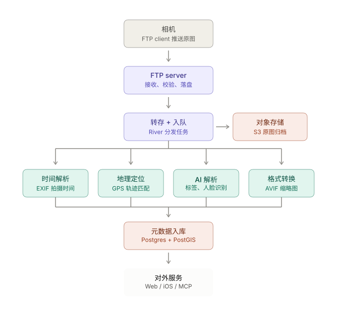

tl;dr

一个无限存储，AI First 的相机照片管理服务

## 普通的开头
其实早先我对摄影和视频是没什么特别的感觉的。

我早年很不明白照片有什么意思，也不懂为什么摄影记录。

和很多人一样，我之前的看法是看过就看过了，体验过就行了。拍照费时费力，还会影响当时的体验。

然后多年过去以后，我偶尔翻看 icloud 相册感觉到了不一样。

…

年初买了新相机，用了大半年之后，又发现了更加不一样的东西 —— 不仅拍摄的记忆有趣，拍摄本身更是一种磕了药一样的体验，我必须要告诉所有能看到这篇文章还尚未接触摄影的朋友：

相机的机械结构实在是太美，参数之精确难以忘怀。相机这种贴着现代物理学和光学的极限来做的东西，它不仅仅拍出来的东西美，本身也是一个现代工业的艺术品。

更重要的是手持相机让我看世界的角度变了，开始寻找光影，研究目之所及的美好，追求更远更高的地方去拍照。这些是我曾经都不在意的东西。

只是同时作为一个程序员我也发现了它落后到可怕的软件部分：

照片存储需要走读卡器，极难存储大量照片。
分享过于复杂，拍摄后需要特别流畅才能传到手机，也需要繁重的后期才可能发得出来
拍摄出的内容，只在脑海中存留，即没有经验，也没有积累，甚至会忘记曾经的风景
在这个 AI 勃勃生机的时代，相机这边似乎没有丝毫反应
于是我思前想后，从 FTP 上传开始，做了这个 rawback.app 的服务

## FTP, S3 与 AI

我们多数情况下拍完照片基本需要把卡拔出来，单独拿个读卡器，然后导入到电脑。但是我发现很多相机内部支持了 FTP client 所以我的想法是能不能做个 FTP server 从相机直接把照片导入到 S3。这样就不会再需要读卡器和线，也不需要管理复杂的文件格式，也无需找文件夹这种情况。

在做 FTP server 的过程中其实想到了既然存储有了，那么能不能做一些后置操作去处理图像？比如简单的图片分析，关键词拆分，因为 raw 很大，可以做 jpg 转换，人脸识别之类的？

说干就干。在 AI 的加持下 1 月 18 号就开始很快写好了第一份代码:

```bash
commit d7a24cceef60ff8fe445a3e473917a25506cd102
Author: AnnatarHe <annatar.he+github@gmail.com>
Date:   Sun Jan 18 12:58:01 2026 +0800

    feat(server): initial implementation of Rawback server

    - Add Ent schemas for ...
    - Implement REST API for ...
    - Implement GraphQL API for ...
    - Add internal API endpoints for ...
    - Implement Asynq background jobs for ...
    - Add JWT authentication and bcrypt password hashing
    - Configure S3 storage integration
    - Add storage plan tiers ...

    Co-Authored-By: Claude Opus 4.5 <noreply@anthropic.com>
```

它的架构正如上文所言比较好理解：

相机作为 FTP client 连接到 FTP server 然后传输图片过去。FTP Server 再将它们转存到 S3 服务，在过程中同时进行复杂又巨大的图片分析，去丰富数据结构。



## 基本功能
你完全可以把它理解成普通的照片管理服务：

- 存储：我拍了很多照片，可以存到 rawback 里。
- 搜索：我想看看之前的照片，也能搜到。
- 人脸识别：我想看看都拍了谁，有人脸聚类。
- 分享：我想发给朋友，有极为丰富的权限，分享和下载策略
- 相册：我想把旅行做成相册。可以，甚至有自动更新的相册
- 修图：我想快速修图。完全可以。有参数修图这种老登最爱。也有 AI 自然语言修图这种 non-thinking 的方式

## AI

上面这些功能我想你都疲惫了。如果只是这种程度它会和众多其他的产品一样泯然众人。丝毫不值得你看到这里，也不值得我写这么多 prompts。重点当然是 AI

1. Analyze 图片分析：主体，场景，情绪分析
2. Article 相册分析写故事

很多时候我们的拍照不只是单张拍照，拍多了，我们会疲劳于完美的东西 —— 一个美景固然好看，可终点的风景如果缺少了沿途的故事便少了点儿味道。

相册把一群单个的图片聚合在一起。配合文字，配合时间，配合地点，配合人物，配合一切。凝聚成难忘的记忆。 

3. Dreaming 自动回顾

相册还是太重了。有时候做的梦似乎也不错。那一片片梦境中的只言片语也能拍下来，凝聚成更长期的 memory 

4. Context 长期记忆

每个人有不同的偏好。有人是风光佬，有人是妹控，有人偏爱纪实，有人喜欢艺术。有人爱用超长焦打鸟，有人爱用大广角观星。在 rawback 数据多了，长期记忆的加持下，不管是分析还是修图都会变得更加得心应手

5. Sunny AI Helper

和众多产品一样，rawback 也有一个全局的助手。只是和其他产品不一样的是我打算做成任意页面 awareness 的产品，提供不同的信息和帮助。而非单纯的只是个 chatbot。

现在在相册编写的页面它可以协助写文章，选照片。

在照片详情页则可以直接调用 AI 自然语言修图

6. CLI, MCP 与 SDK

没想到吧，一个面向拍照的产品竟然有完整的 CLI 支持。自主控制上传下载，分类等等众多功能。实在是太多了自己看接口文档吧 [https://rawback.app/download/cli](https://rawback.app/download/cli)

更没想到的是它还有 MCP 支持。你连上 Claude 甚至可以用 Fable 5 来对图片做操作。拿 OpenAI image-gpt-2 做图。或者任意支持 MCP 的地方来调用。 [https://rawback.app/download/mcp](https://rawback.app/download/mcp)

然后。产品提供了一个 SDK 出来，封装了下层的接口调用等。你实在是不爽我的产品也嫌弃 AI 只想用存储和 AI 完完全全没问题。通过 SDK 我相信你很容易做出一个自己的客户端或者小工具。没功能的话直接开个 issue 给我。能做肯定做。 [https://rawback.app/download/sdk/guide](https://rawback.app/download/sdk/guide)

## 价格

具体看官网价目表吧。

和其他产品不太一样的是分了三个类型，分别是 存储， AI，人脸服务。支持 all in one 的 bundle 也支持极端用户多买 addons

这个价格我不能说很便宜，但我想说的是功能要比普通的产品丰富多了。当然成本也高很多。存储和计算成本都算不得低。

但免费存储还是比较大方的，5Gb 的空间可以先试试看。

## 问题
当然产品现在有很多问题

比如图片加载其实挺卡的，我尽力了。但这个没招了。接下来再优化就得换 cdn 提供商了。而这个成本对我来说暂时是承担不起的。我相信你能看到文章多多少少都是程序员，你知道 S3 存储的价格，更知道流量费绝不便宜。

另一方面是图片分析转换和各种计算。其中一些任务比较吃计算。所以就造成大量图片上传的时候处理速度很慢。这又是一个加钱就能解决的问题。可惜还是因为成本原因只能忍一下。

其实做程序员这么多年要说我最自信的就是自己 “抠” 的事情，买服务器，服务，甚至架构设计，写服务代码的语句，部署的环境我都是极致追求价格低的情况下有一定的性价比。而 rawback 的压力更重，我在做的时候就更极致了。

这个服务是我在全球拼凑了 5 台服务器混合处理的，对于降低成本我感觉已经到极限了 😂

## AI 来了，需要摄影吗？
接下来，我想自己聊一个问题 —— AI 来了，还需要摄影吗？

我的回答比较简单：只要还有情感，真实与爱，就还需要

AI 的发展毫无疑问是突飞猛进的。从 GPT 3.5 问世到今天 Fable 5 甚至可以写出相当不错的设计，中间也就不到 4 年。AI 的发展也从最早期的纯文字到今天的多模态甚至包括视频生成。

这个 rawback 的项目我看了下，大概 900 条对话记录。（通过 shelltime.xyz 记录的，如果你感兴趣也可以试试），AI 写的代码率占到了 95% 以上。这种开发模式已经和之前的模式非常不一样。

Boris 甚至说到代码问题已然解决

[https://x.com/bcherny/status/2091589188298891264](https://x.com/bcherny/status/2091589188298891264)

摄影，还有意义吗？

当然，AI 在我看来对摄影的冲击是巨大的，可同样对任何其他行业的冲击丝毫不比摄影小。甚至一些看起来铁饭碗的行业在后 AI 时代的颠覆下都会被大规模变革。

摄影和其他很多事情不太一样的是它并不是一个生存需求。你会不会拍照并不太对影响晚上能不能吃上饭。我被不被拍照也不会影响晚上的加班。

可是摄影在很多时候它就像一首歌，一部电影，一本书一样 —— 会产生极大的冲击力。让人感受到美，感受到丑，感受到壮烈的河山，感受到人间的残酷。它是情感，是真实，更重要的是，爱。

我们会在多年之后翻看相册，依然可以感受出玄武湖的宁静，依然记得宁国路的燥热。我可能累了，但札幌的烧肉依旧飘香。我可能老了，但 MBS 的微风还会在照片中长存。

AI 能做到吗？

不远的将来，它也许会产生意识，产生情感，产出另一种真实。可你我活着的记忆，它大概暂时没办法创造。

现在，感受当下

-----------

最后，希望你能喜欢摄影，也顺便试下 rawback，但愿它能帮你解决问题。

下面是注册链接。需要注册码，我想先保守一把

[https://rawback.app/auth/register?code=33FVRSPQ](https://rawback.app/auth/register?code=33FVRSPQ)

有任何问题可以在任意渠道联系我，只要看到就会回复。或者邮箱: [annatarhe@gmail.com](mailto:annatarhe@gmail.com)
